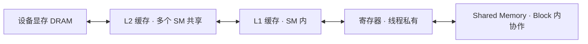
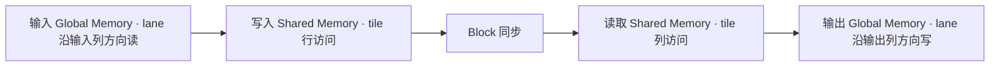

# GPU 内存层级与访存优化

前置笔记介绍了 Warp、SM 和 Block 内的协作。本篇用 NVIDIA CUDA 的访存模型，讨论一条 Warp 指令怎样访问 Global Memory 或 Shared Memory，以及多个 Block 怎样复用已经进入 L2 的数据。[GPU 执行模型入门](<GPU 执行模型入门.md>) · [TileLang 学习计划](<TileLang 学习计划.md>)

| 概念 | 分析范围 | 先算什么 |
| --- | --- | --- |
| **Coalescing（合并访存）** | 一条 Warp 的 Global Memory load 或 store | 所有参与线程的地址覆盖多少个 32 B sector |
| **Bank conflict（存储体冲突）** | 一条 Warp 的 Shared Memory 访问 | 同一个 bank 收到多少个不同地址的请求 |
| **L2 cache（L2 缓存）** | SM 发出的请求以及不同请求之间的数据复用 | 数据上一次被访问后，能否留在 L2 直到下一次访问 |

## 1. 数据在 GPU 上经过哪些层级

以下是一次普通 Global Memory load 的简化路径。L1 是否参与取决于指令和缓存策略。支持异步拷贝的 GPU 还可以沿专用路径把数据送入 Shared Memory。路径与计数单位见 [Nsight Compute Profiling Guide](https://docs.nvidia.com/nsight-compute/ProfilingGuide/index.html#memory-chart)。



| 层级 | 作用域或服务范围 | 数据怎么进入 |
| --- | --- | --- |
| 寄存器 | 线程私有，物理资源位于 SM | 编译器分配，用于暂存操作数、累加值和索引 |
| Shared Memory | 普通用法中属于一个 Block，位于 SM | kernel 通过显式拷贝或 store 写入，之后由线程协作读取 |
| L1 | SM 内的硬件缓存 | 由硬件根据访问路径和缓存策略填充、替换 |
| L2 | 多个 SM 共享的硬件缓存 | 设备内存访问经过缓存层级时由硬件管理，可在支持的设备上提供保留策略提示 |
| Global Memory | 全局地址空间，可供设备线程访问，常规设备分配由显存承载 | 例如通过设备分配得到的输入、输出和中间张量 |

`Global Memory` 描述程序访问的地址空间。一条 global load 可以在 L1 或 L2 获得数据，只有相应缓存未命中时才需要从更远的层级取数。`Local Memory` 也属于地址空间概念。它保存线程私有的数组或寄存器溢出值，普通设备上的后备存储也在显存中，访问可以经过缓存。

L1 和 Shared Memory 在许多 NVIDIA 架构上使用同一组可划分的片上存储资源。Shared Memory 的占用量还影响一个 SM 同时能驻留多少个 Block。因此扩大 tile 时，需要一并评估数据复用、片上容量、寄存器压力和占用率。[CUDA 编程模型](https://docs.nvidia.com/cuda/cuda-programming-guide/01-introduction/programming-model.html) · [CUDA 最佳实践中的 Local Memory](https://docs.nvidia.com/cuda/cuda-c-best-practices-guide/index.html#local-memory)

## 2. Coalescing（合并访存）

### 2.1 用 32 B sector 数一条 Warp 指令的请求

在 CUDA Compute Capability 6.0 及之后的常见 Global Memory 访问模型中，用 **32 B 对齐的 sector** 分析 Warp 访存。每条 load 或 store 分别统计参与线程覆盖的 sector。对一个大小为 `size`、起始字节地址为 `addr` 的访问，它覆盖从 `addr // 32` 到 `(addr + size - 1) // 32` 的所有 sector。对活跃 lane 取并集，就得到这条指令需要的 sector 集合。[CUDA 最佳实践中的合并访存](https://docs.nvidia.com/cuda/cuda-c-best-practices-guide/index.html#coalesced-access-to-global-memory)

一个 `float32` 占 4 B。设 `A` 的起始地址按 32 B 对齐，Warp 的 32 个 lane 每个读一个 `float`，相邻 8 个 lane 共同填满一个 sector。

```text
lane      0 ... 7     8 ... 15    16 ... 23    24 ... 31
读 A      A[0:8]      A[8:16]     A[16:24]     A[24:32]
sector    0           1           2            3
字节范围  0～31       32～63      64～95       96～127
```

这里读到 128 B 不重复的数据，恰好使用 4 个 sector。下表中的“覆盖利用率”是 **不重复的有效字节数 ÷ 覆盖的 sector 字节数**，便于比较地址模式。每个例子都假设 `A` 基址按 32 B 对齐，`l` 为 lane 编号。

| 每 lane 读取 | 触及的 sector 数 | 覆盖利用率 | 原因 |
| --- | ---: | ---: | --- |
| `A[l]` | 4 | 100% | 32 个连续 `float` 正好填满 4 个 sector |
| `A[31 - l]` | 4 | 100% | 读取顺序相反，地址集合相同 |
| `A[l + 1]` | 5 | 80% | 访问从字节 4 开始，到字节 131 结束 |
| `A[2 * l]` | 8 | 50% | 每个 sector 内只有 4 个 `float` 被使用 |
| `A[4 * l]` | 16 | 25% | 每个 sector 内只有 2 个 `float` 被使用 |
| `A[8 * l]` | 32 | 12.5% | 每个 lane 读不同的 sector |
| 仅 lane 0～7 读取 `A[l]` | 1 | 100% | 8 个活跃 lane 正好用满 1 个 sector |

所有 lane 读取 `A[0]` 时，也只触及 1 个 sector，请求中只有 4 B 不重复的数据。它适合表达 Warp 内对同一输入的复用。评估这种模式时，要同时看活跃 lane、每 lane 读取宽度和地址重叠情况。

Sector 数描述的是这条指令的**请求覆盖范围**。`A[l + 1]` 的相邻 Warp 可能复用彼此多触及的 sector，后续缓存可以降低重复传输。每条指令的 sector 数、L1 与 L2 之间的流量、显存实际流量，应分别观察。[CUDA 最佳实践中的错位访问](https://docs.nvidia.com/cuda/cuda-c-best-practices-guide/index.html#a-sequential-but-misaligned-access-pattern) · [Nsight Compute 的 L1 表](https://docs.nvidia.com/nsight-compute/ProfilingGuide/index.html#l1-tex-cache)

### 2.2 矩阵、步长和线程布局

对于 row-major 的二维张量，`ld` 为相邻两行起点之间的**元素数**。连续的 `H × W` 矩阵通常有 `ld = W`，带 padding 的矩阵可以有 `ld > W`。

```text
addr(row, col) = base + (row * ld + col) * sizeof(T)
```

- Warp 内 `row` 固定、`col = col0 + lane`，访问连续的元素。对于 `float32`，行起点和 `col0` 对齐时，完整 Warp 只需要 4 个 sector。
- Warp 内 `row = row0 + lane`、`col` 固定，相邻 lane 相隔 `ld * sizeof(T)` 字节。当间隔至少 32 B 时，`float32` 的 32 个活跃 lane 会触及 32 个 sector。
- 线程分组也要结合 `blockDim`。`blockDim.x = 32` 时，同一 Warp 对应相同的 `threadIdx.y`。`blockDim.x = 16` 时，一个 Warp 跨两个 `threadIdx.y` 值，每组 16 个 lane 的地址都要计入。

如果输入是转置视图或切片，使用实际的 stride 和偏移来算地址。一个逻辑上连续的 tile 可能位于带间隔的物理行里。`float32` 的连续行每行长度为 33 时，第二行的起点相对第一行偏移 132 B，相对 32 B 对齐边界多出 4 B。

### 2.3 每线程处理多个元素时，按指令分析

考虑一个 Warp 读 128 个 `float`。若每个线程循环读取 `A[4 * lane + j]`，`j` 从 0 到 3，编译为四条标量 load 时，每条指令的 lane 间距都是 4 个元素。若用 `A[32 * j + lane]`，每次迭代内的 32 个 lane 都读连续位置。两者覆盖的总元素相同，每条指令的 sector 数却分别是 16 和 4。缓存仍可能让第一种写法在四次访问间复用 sector。

另一种方案是每个 lane 读取一个 `float4`。若编译成一条向量 load，地址满足 16 B 自然对齐，且整个 Warp 从 32 B 对齐地址开始读取 512 B 连续数据，则一条指令覆盖 16 个 sector。判断向量化效果时，还要看实际指令、尾部处理和寄存器用量。[Nsight Compute 对访问宽度的说明](https://docs.nvidia.com/nsight-compute/ProfilingGuide/index.html#l1-tex-cache) · [CUDA 编程指南中的设备内存访问](https://docs.nvidia.com/cuda/cuda-programming-guide/02-basics/writing-cuda-kernels.html)

常见优化包括把连续的 lane 映射到 stride 最小的维度，为带偏移的切片保留合理对齐，以及在只需读取某一字段时评估结构体数组（AoS）与字段分离数组（SoA）的布局。比如 `struct { float x, y, z, w; }` 数组只读 `x` 时，lane 间距为 16 B。单独存放 `x[]` 可以让该 load 使用连续地址。[Nsight Compute 的内存访问分析](https://docs.nvidia.com/nsight-compute/ComputeTriage/#memory-access-patterns-and-transaction-efficiency)

## 3. Bank conflict（Shared Memory 存储体冲突）

### 3.1 从地址算 bank

本节先用 32 个 bank、连续 32-bit 字分布到连续 bank 的模型。每个 lane 访问一个对齐的 4 B 字时，bank 编号为 `bank = (byte_address // 4) % 32`。多个 bank 可以并行提供数据。同一个请求中，同一 bank 收到多个**不同字地址**时，需要分次服务。[CUDA 最佳实践中的 Shared Memory Banks](https://docs.nvidia.com/cuda/cuda-c-best-practices-guide/index.html#shared-memory-and-memory-banks)

下表假设 `float s[]` 的起始 bank 为 0，32 个 lane 都参与读取。

| 读取方式 | bank 编号序列 | 冲突程度 |
| --- | --- | --- |
| `s[lane]` | `0, 1, 2, ..., 31` | 每个 bank 服务一个地址，无冲突 |
| `s[2 * lane]` | `0, 2, ..., 30, 0, 2, ...` | 16 个 bank 各服务两个地址，2-way |
| `s[4 * lane]` | `0, 4, ..., 28, 0, 4, ...` | 8 个 bank 各服务四个地址，4-way |
| `s[32 * lane]` | `0, 0, ..., 0` | 一个 bank 服务 32 个不同地址，32-way |
| `s[33 * lane]` | `0, 1, ..., 31` | 地址间隔大，bank 均匀分布，无冲突 |
| `s[0]` | `0, 0, ..., 0` | 多个 lane 读取同一个字，可广播 |

对于完整 Warp 访问 `s[base + stride * lane]`，其中 `stride > 0`，每个 lane 读一个不同的 32-bit 字，**每个被使用的 bank 收到的地址数为 `gcd(stride, 32)`**。因为 bank 序列每 `32 / gcd(stride, 32)` 个 lane 重复一次。若只有部分 lane 活跃，可直接按 bank 分组数不同字地址。多个 lane 同时写同一个地址还涉及写入正确性，需要独立分析。

### 3.2 行读、列读和 padding

对 Shared Memory 中的 `float tile[32][32]`，行跨度 32，`bank(row, col) = (32 * row + col) % 32 = col`。一个 Warp 的 lane 固定行、沿列读时，32 个 lane 对应 32 个 bank。固定列、沿行读时，32 个不同字地址全部落入列号对应的 bank。

把物理布局改成 `float tile[32][33]`，逻辑 tile 仍使用前 32 列。此时 `bank(row, col) = (row + col) % 32`。沿行读和沿列读都能分散到不同 bank。代价是每个 Block 多用 `32 × 4 = 128 B` Shared Memory，物理行跨度也随之改变。[NVIDIA 的矩阵转置示例](https://developer.nvidia.com/blog/efficient-matrix-transpose-cuda-cc/)

### 3.3 Swizzle 和更宽的访问

Swizzle 把逻辑下标映射到新的物理下标。可以在一个教学用的 `32 × 32`、每元素 4 B 的 tile 中定义 `physical_col = col ^ row`，其中 `row` 和 `col` 都在 0～31。固定行时，`col ^ row` 枚举 32 个不同的 bank。固定列时，`col ^ row` 也随行变化枚举 32 个不同的 bank。写入者和读取者必须使用同一映射，才能从同一个位置取得逻辑元素。

实际 GEMM 的 FP16/BF16、向量 load 和矩阵专用指令有各自的访问宽度与 lane 映射。分析时先确定生成的指令和它分成的服务请求，再在每个请求内数各 bank 的字地址。每个 lane 读取 8 B 或 16 B 时，一条 Warp 指令即使没有额外的冲突，也可能需要多个 wavefront 才能服务所有字。可以在 profiler 里把实际 wavefront 和该指令的理想 wavefront 一起比较。[Nsight Compute 对 Shared Memory wavefront 的说明](https://docs.nvidia.com/nsight-compute/ComputeTriage/#symptom-shared-memory-bank-conflicts-are-significant)

## 4. 用矩阵转置把前两项串起来

设输入 `src` 是 `H × W` 的连续 row-major `float32` 矩阵，输出 `dst` 是独立的 `W × H` 连续矩阵。目标为 `dst[x * H + y] = src[y * W + x]`。

若让连续的 lane 对应输入的 `x`，同一个 Warp 读入连续地址，写出地址的间隔却是 `H * 4` B。Shared Memory tile 允许负责连续读入的线程先协作暂存数据，然后按输出布局重新分配写回工作。具体过程如下图。



下面的 CUDA C++ 片段可放进已有的 CUDA 程序。用 `32 × 8` 个线程覆盖 `32 × 32` 的 tile，每个线程每一阶段处理四个位置。`PAD` 设为 0 或 1，可以比较相同 Global Memory 地址模式下的两种 Shared Memory 布局。假设 `H、W > 0`，设备指针已分配且输入和输出不重叠。

```cpp
template <int PAD>
__global__ void transpose_tiled(const float* src, float* dst, int H, int W) {
    constexpr int TILE = 32;
    constexpr int ROWS = 8;
    __shared__ float tile[TILE][TILE + PAD];

    const int tx = threadIdx.x;
    const int ty = threadIdx.y;
    const int x0 = blockIdx.x * TILE;
    const int y0 = blockIdx.y * TILE;

    for (int j = 0; j < TILE; j += ROWS) {
        const int x = x0 + tx;
        const int y = y0 + ty + j;
        if (x < W && y < H) {
            tile[ty + j][tx] = src[static_cast<size_t>(y) * W + x];
        }
    }

    __syncthreads();

    for (int j = 0; j < TILE; j += ROWS) {
        const int out_row = x0 + ty + j;
        const int out_col = y0 + tx;
        if (out_row < W && out_col < H) {
            dst[static_cast<size_t>(out_row) * H + out_col] = tile[tx][ty + j];
        }
    }
}

// Host 端，按要比较的版本选择其中一次启动。
dim3 block(32, 8);
dim3 grid((W - 1) / 32 + 1, (H - 1) / 32 + 1);
transpose_tiled<0><<<grid, block>>>(src, dst, H, W);
// transpose_tiled<1><<<grid, block>>>(src, dst, H, W);
```

1. 写入 `tile[ty + j][tx]` 时，`tx` 随 lane 变化。读源矩阵和写 Shared Memory 都沿一行进行。
2. `__syncthreads()` 在边界分支之外。每个 Block 中的所有线程都会到达屏障。写回条件与对应源元素的读入条件一致，边缘有效输出仍能找到已写入的 tile 元素。
3. 读取 `tile[tx][ty + j]` 时，`tx` 现在是 Shared Memory 的行号。同一个 Warp 读同一列的多个行，`PAD = 0` 发生 32-way 冲突，`PAD = 1` 使 bank 编号随 `tx` 改变。
4. 写 `dst` 时，`out_col` 随 lane 变化，沿输出矩阵一行写回。源和目的矩阵的行起点对齐时，完整 Warp 的 global load 和 store 都只覆盖 4 个 sector。边缘 tile 和未对齐的行按第 2 节计算。

## 5. L2 缓存与跨 Block 复用

### 5.1 命中、工作集和复用距离

多个 SM 都能通过 L2 访问同一份 Global Memory 数据。假设 Block A 从显存读入一块数据，Block B 随后读相同地址，只要相关 sector 仍在 L2，B 就可能在 L2 命中，即使 A 和 B 运行在不同 SM。这里两个 Block 各自发出 global load，硬件缓存承担重复读取的数据供给。[CUDA 编程指南中的 L2 缓存控制](https://docs.nvidia.com/cuda/cuda-programming-guide/04-special-topics/l2-cache-control.html)

工作集和复用距离都会影响命中机会。

- **工作集**是在一段执行期间频繁访问的数据量，包括同一时段的输入、输出和其他并发访问。
- **复用距离**可粗略理解为两次访问同一份数据之间，访问过多少其他不同数据。中间引入的数据越多，该数据越容易被替换。缓存组映射、替换策略和其他访问也会改变命中结果。

例如先读 `A0`，再读 `A1、A2、…`，很久之后再读 `A0`，复用距离可能很大。若接下来几个 Block 都访问 `A0`，则相关 sector 有较高机会留在 L2。一次性流式读过的大数组主要受读取带宽和合并效果影响。反复读的权重、索引表或 GEMM 输入 tile 更容易从缓存复用获益。

L2 命中率的分母是到达 L2 的 sector 请求数。下表比较两个版本的同类读取。

| 版本 | L2 sector 请求数 | L2 命中率 | L2 未命中的 sector 数 |
| --- | ---: | ---: | ---: |
| A | 100 | 90% | 10 |
| B | 20 | 60% | 8 |

B 的命中率更低，但未命中数更少。比较 L2 优化时，同时看请求数、未命中数、DRAM 读写字节数和 kernel 耗时。更早的 L1 命中也会改变到达 L2 的请求构成。[Nsight Compute 的 L2 表](https://docs.nvidia.com/nsight-compute/ProfilingGuide/index.html#l2-cache)

### 5.2 GEMM 中有哪些跨 Block 的复用

设一个 Block 负责 `C` 的一块输出，逻辑坐标为 `(bx, by)`。每一轮取 K 维上的第 `ko` 块做乘加。

```text
C[by, bx] += A[by, ko] × B[ko, bx]    # 这里的下标是 tile 坐标
```

- 固定 `by`，改变 `bx` 时，输出 tile 在同一行，复用 `A[by, ko]`。
- 固定 `bx`，改变 `by` 时，输出 tile 在同一列，复用 `B[ko, bx]`。

如果访问同一份输入的 Block 在时间上接近，对应的 A 或 B tile 就更容易被 L2 保留。Threadblock swizzle 通过重映射物理 Block ID 对应的逻辑 tile，改变相邻 Block 访问的数据。选择哪个方向分组、分组多大，取决于矩阵形状、输入的访问量、缓存压力及实际调度。Block 之间的正确性仍应独立于实际执行顺序。[TileLang 的 DeepSeek MLA 文档](docs/deeplearning_operators/deepseek_mla.md#threadblock-swizzling)

### 5.3 L2 控制是进阶选项

支持该功能的 CUDA 设备可以为 L2 的 persisting accesses 预留一部分容量，并为某个 CUDA stream 配置 access-policy window。窗口指定一个地址范围和保留提示，适合反复访问、且规模可控的数据。窗口参数 `hitRatio` 用于控制采用所配置缓存属性的访问比例。实际命中率由测量得到。多个窗口和并发 stream 都会争用保留空间，窗口过大可能增加替换压力。[CUDA L2 Cache Control](https://docs.nvidia.com/cuda/cuda-programming-guide/04-special-topics/l2-cache-control.html)

## 6. 回到 TileLang 的 quickstart

沿用上一节的示例。`M = N = K = 1024`，`block_M = block_N = 128`，`block_K = 32`。Grid 有 `8 × 8` 个 Block，每个 Block 128 个线程，并沿 K 维迭代 32 次。[quickstart.py](examples/quickstart.py)

| 示例中的操作 | 可以怎样分析 |
| --- | --- |
| `T.copy(A[by * block_M, ko * block_K], A_shared)` | Global Memory 中 A 的 K 维连续。查看 lowering 如何为每条 load 分配 lane、向量宽度或异步拷贝。 |
| `T.copy(B[ko * block_K, bx * block_N], B_shared)` | Global Memory 中 B 的 N 维连续。检查生成的访问是否把连续 lane 或拷贝区域放在这一维。 |
| `T.gemm(A_shared, B_shared, C_local)` | A、B 在 Block 内多次参与矩阵乘加。Shared Memory 布局要与底层矩阵指令的读取方式匹配。 |
| `T.copy(C_local, C[by * block_M, bx * block_N])` | 将分布于线程的 fragment 写回 Global Memory。检查写回的线程映射、宽度和边界条件。 |
| `T.Pipelined(..., num_stages=3)` | 尝试让不同 K 分块的搬运和计算重叠。多份缓冲可能占用更多 Shared Memory，影响驻留 Block 数。 |

每个 Block、每个 `ko` 的 A 和 B 逻辑输入数据量为 `(128 × 32 + 32 × 128) × 2 B = 16 KiB`。按 32 次迭代、64 个 Block 计算，所有 Block 合计读取 **32 MiB 的逻辑输入数据**。矩阵 A 和 B 本身各占 2 MiB。若同一元素的后续读取都能由缓存满足，且不计对齐、预取等额外流量，显存输入读取有机会接近 **4 MiB**。这两个数分别描述 Block 发出的逻辑数据需求和理想的显存流量，实际用 Nsight Compute 观察。

### 6.1 区分两种 swizzle

| 做法 | 改动的位置 | 影响的访存现象 |
| --- | --- | --- |
| `T.use_swizzle(panel_size=10, enable=True)` | Block ID 到逻辑输出 tile 的映射。仓库中默认 `order="row"`，另一种方向为 `"column"`。 | 改善相邻 Block 的输入 tile 复用机会，从而影响 L2 访问。 |
| `T.annotate_layout({buf: tilelang.layout.make_swizzled_layout(buf)})` | 一个 Shared Memory buffer 的逻辑下标到物理地址的映射。 | 改变不同线程访问的 bank。要与拷贝和计算指令的要求匹配。 |

`T.use_swizzle` 已作为可选注释放在 `quickstart.py` 中。可以用同一组输入分别编译默认版和开启版，验证结果后比较耗时与 L2/DRAM 流量。示例尺寸只有 64 个 Block，两份输入共 4 MiB，优化收益可能不明显。还可以比较更大的矩阵，观察工作集和 Block 数改变后的结果。Shared Memory 布局可先查看编译器为 `T.gemm` 推导的布局，再决定是否做显式标注。[quickstart.py](examples/quickstart.py) · [TileLang 标注接口](tilelang/language/annotations.py) · [TileLang Shared Memory 布局实现](tilelang/layout/swizzle.py)

## 7. 怎么验证优化

### 7.1 在本机算地址

下面的 Python 可以直接运行。`sectors()` 数覆盖的 32 B sector，`bank_service_rounds()` 用集合合并相同字地址，再数同一 bank 上不同字地址的最大数量。它模拟的是单条 Warp 指令、每 lane 读取一个对齐的 `float32` 的情况。

```python
def sectors(indices, base_bytes=0):
    covered = set()
    for index in indices:
        start = base_bytes + 4 * index
        covered.update(range(start // 32, (start + 3) // 32 + 1))
    return len(covered)


def bank_service_rounds(indices):
    banks = [set() for _ in range(32)]
    for word in indices:
        banks[word % 32].add(word)
    return max(map(len, banks))


print(sectors(range(32)))                           # 4
print(sectors(range(32), base_bytes=4))              # 5
print(sectors(8 * lane for lane in range(32)))       # 32
print(bank_service_rounds(32 * l for l in range(32)))  # 32
print(bank_service_rounds(33 * l for l in range(32)))  # 1
print(bank_service_rounds([0] * 32))                 # 1
```

### 7.2 在 CUDA 机器上做对照实验

1. **合并访存**。写一个读 `A[stride * i]`、连续写 `out[i]` 的 kernel。分别用 `stride = 1、2、8`，保证 A 足够大，并选择使 Grid 没有尾部的 `N`。先比较 global load 的 sector/request，再看总 DRAM 流量。`stride` 会同时改变输入工作集，实测时间还受到缓存影响。
2. **Bank conflict**。在相同 `H、W` 和线程配置下比较 `transpose_tiled<0>` 与 `<1>`。先用 `dst[x * H + y] == src[y * W + x]` 检查结果，可用 `H = 65、W = 97` 验证边界。性能对照用更大的整 tile 尺寸，分别记录 global load/store sector 与 shared load 的 wavefront 或 bank-conflict 计数。
3. **L2 复用**。比较 TileLang GEMM 的默认版和开启 Block swizzle 的版本。固定输入、dtype、tile 尺寸、流水线深度、预热和测量方式。观察 L2 sector、L2 miss、DRAM 读取字节及耗时，判断命中变化是否减少显存读取。

先检查计算结果，再用 CUDA events 或 TileLang profiler 计时。单独用 Nsight Compute 查看访存指标，下面的 `./your_benchmark` 指已经编译好的对照程序。

```bash
ncu --section MemoryWorkloadAnalysis --section MemoryWorkloadAnalysis_Tables ./your_benchmark
```

| 观察位置 | 指标 | 对照方式 |
| --- | --- | --- |
| L1/TEX 表的 global load 或 store | `Sectors/Req`、sector 数 | 对照同样的活跃 lane 数与每 lane 访问宽度。32 个 lane 各访问一个不同且连续、对齐的 `float32` 时，理想值为 4。 |
| Shared Memory 表及 Source 视图 | `Bank Conflicts`、`Wavefronts` | 优先定位到对应 shared 指令。宽访问与多条指令本身可能需要多个 wavefront。 |
| L2 表 | `Sectors`、`Hit Rate`、`Sector Misses to Device` | 对照请求与未命中数量。用命中率解释变化，再看实际显存流量。 |
| Device Memory 表 | DRAM 读写字节和吞吐 | 观察实际下沉到显存的流量，结合 kernel 时间判断收益。 |

Nsight Compute 默认在 replay pass 前清理 GPU 缓存。分析连续 kernel 或预热后的 L2 状态时，可用 `--replay-mode application --cache-control none`，并由程序按真实顺序重现预热和待测 kernel。对照实验保持一致的缓存设置。[Nsight Compute Memory Tables](https://docs.nvidia.com/nsight-compute/ProfilingGuide/index.html#memory-tables) · [Cache Control](https://docs.nvidia.com/nsight-compute/ProfilingGuide/index.html#cache-control)

## 8. 自测

1. 起点按 32 B 对齐，32 个 lane 读取 `A[2 * lane + 1]`，一共覆盖多少个 sector？
2. Shared Memory 的 `float tile[32][34]` 按列读，一个 Warp 有几路 bank conflict？
3. `float tile[32][33]` 的行跨度对 Shared Memory 列访问和 Global Memory 连续行分别有什么影响？
4. 在 GEMM 中把相同 `by` 的 Block 放在一起，主要尝试复用哪个输入 tile？
5. 为什么优化后 L2 命中率可能下降，DRAM 读取量却减少？

> [!success]- 参考答案
> 1. 8 个。访问元素为 1、3、…、63，每个 sector 有 4 个被读取的 `float32`。
> 2. 2-way。`34 % 32 = 2`，访问落在 16 个 bank，每个 bank 收到两个不同字地址。
> 3. Shared Memory 的列访问用 33 的行跨度可以遍历全部 bank。Global Memory 中若也使用 33 个 `float32` 的行跨度，每行起点比上一行多偏移 4 B（对 32 B 取模），部分行的连续访问会多覆盖一个 sector。
> 4. 在同一个 `ko` 上，这些 Block 访问相同的 `A[by, ko]`。
> 5. L2 请求数可能降得更多，例如 coalescing 改善后减少了很多冗余请求。用 sector 未命中数量与 DRAM 读字节判断实际变化。
