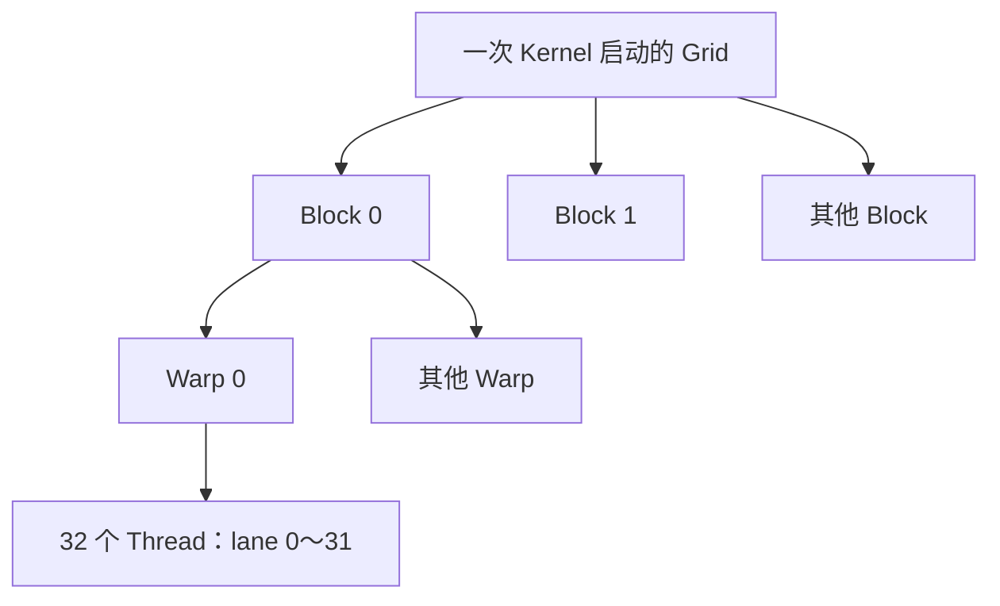
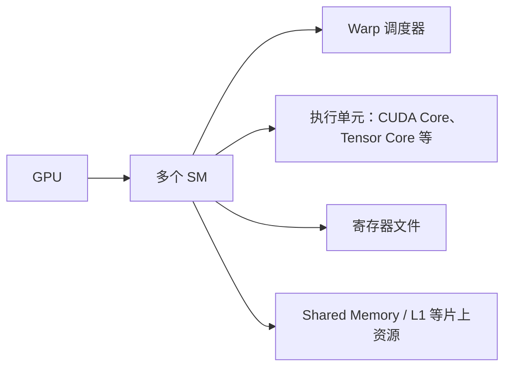

# GPU 执行模型入门

关联计划：[[TileLang 学习计划]] → 阶段 0：前置知识。

本文以 **NVIDIA GPU / CUDA** 为背景，介绍 Grid、Block、Warp、Thread，以及 SM、Shared Memory、寄存器，并对应到本仓库的 TileLang 示例。AMD、Ascend 等后端有各自的执行模型，不能直接套用“Warp 固定 32 个线程”等细节。

建议阅读顺序：先看第 1～4 节建立执行模型，再看第 5～7 节理解数据与计算，最后做自测。第一次阅读不需要运行 GPU 程序。

## 1. 先分清：任务怎么组织，硬件怎么执行

CPU 端启动一个 **Kernel（核函数）**，GPU 上的许多线程执行它。理解执行模型时，需要同时看两张图。



这张图表示**工作如何划分**。另一条线是硬件：



**Grid / Block / Thread 是程序组织工作的概念；SM 是承载这些工作的硬件。Warp 则连接了线程组织与硬件调度。** 基础模型中，一个 Block 的线程在同一个 SM 上执行；一个 SM 可以同时驻留多个 Block。[CUDA 编程模型](https://docs.nvidia.com/cuda/cuda-programming-guide/01-introduction/programming-model.html)

## 2. Grid、Block、Thread：从一次向量加法开始

假设计算 `C[i] = A[i] + B[i]`，共有 `N = 1000` 个元素。先采用“一线程处理一个元素”的简单划分。

### Thread：一个逻辑执行实例

每个线程运行相同的核函数，但使用不同的索引，因而处理不同的数据。线程拥有自己的执行状态和私有变量；一个线程也可以通过循环处理多个元素。

下面是 CUDA C++ 示例，仅展示核函数和启动方式。启动前需要准备好设备上的 `A、B、C`，完整程序还需要分配内存、传输数据和检查错误。

```cpp
__global__ void add(const float* A, const float* B, float* C, int N) {
    int i = blockIdx.x * blockDim.x + threadIdx.x;
    if (i < N) {
        C[i] = A[i] + B[i];
    }
}

// CPU 端发起启动；A、B、C 是设备指针。
int threads = 256;
int blocks = (N + threads - 1) / threads;
add<<<blocks, threads>>>(A, B, C, N);
```

### Block：一组可以协作的线程

每个 Block 有 `256` 个线程。Block 内的线程可以通过 Shared Memory 交换数据，并进行 Block 范围的同步。

| 表达式 | 含义 | 本例取值 |
| --- | --- | --- |
| `threadIdx.x` | 线程在 Block 内的编号 | 0～255 |
| `blockDim.x` | 每个 Block 在 x 方向的线程数 | 256 |
| `blockIdx.x` | Block 在 Grid 内的编号 | 0～3 |
| `gridDim.x` | Grid 在 x 方向的 Block 数 | 4 |

例如，Block 2 的线程 10 负责 `i = 2 × 256 + 10 = 522`。

### Grid：这次启动的所有 Block

`ceil(1000 / 256) = 4`，所以 Grid 中有 4 个 Block，共启动 `1024` 个线程。前 `1000` 个线程负责有效元素，最后 `24` 个线程被 `if (i < N)` 屏蔽。

Grid 和 Block 都可以使用一维、二维或三维索引，方便对应向量、矩阵、体数据。维度用于组织索引，二维 Block 并不天然比一维 Block 快。

> [!important] 普通 Block 之间不保证执行顺序
> Block 3 可能比 Block 0 更早完成。不要假设所有 Block 同时运行，也不要让普通 Kernel 中的一个 Block 自旋等待另一个尚未调度的 Block。跨 Block 的阶段依赖，入门时可用同一 CUDA stream 中前后两次 Kernel 启动来组织。

以上索引和层级遵循 [CUDA 编程模型](https://docs.nvidia.com/cuda/cuda-programming-guide/01-introduction/programming-model.html)。

## 3. Warp：线程如何成组执行

在 NVIDIA CUDA 中，一个 Warp 包含 **32 个线程位置**，位置编号称为 lane，范围是 `0～31`。Block 内按线性线程编号依次组成 Warp，Warp 不会跨 Block：

```text
一个 128 线程的 Block
├── Warp 0：线程   0～31
├── Warp 1：线程  32～63
├── Warp 2：线程  64～95
└── Warp 3：线程  96～127
```

对于多维 Block，线性编号为：

```text
tid = threadIdx.x
    + blockDim.x * (threadIdx.y + blockDim.y * threadIdx.z)
warp_id = tid / 32       // 整数除法，Block 内的 Warp 编号
lane_id = tid % 32
```

如果一个 Block 只有 `40` 个线程，它仍需要 `2` 个 Warp，第二个 Warp 只有 `8` 个有效线程位置。

CUDA 使用 **SIMT（Single Instruction, Multiple Threads）** 模型：线程有各自的数据和状态，硬件把同一 Warp 中参与执行的线程组织起来发射指令。因此，“一条指令让多个线程各自处理数据”是理解 Warp 的起点。

如果同一 Warp 中的线程走不同分支，就可能出现 **分支发散（divergence）**：

```cpp
if (threadIdx.x % 2 == 0) {
    // 偶数线程执行路径 A
} else {
    // 奇数线程执行路径 B
}
```

当它被编译为分支执行时，各路径需要分别让对应线程参与，部分 lane 暂时不工作。实际也可能使用谓词指令，不能仅凭源码断定开销。

> [!note] Warp 成组执行不等于自动同步
> Volta 及之后的独立线程调度允许更灵活的执行。线程之间交换数据时，应使用正确的同步原语；不能依赖“同一个 Warp 肯定每一步都同步”。Warp 内同步可使用 `__syncwarp(mask)`，参与掩码必须符合实际线程集合。

Warp 与独立线程调度的定义见 [CUDA SIMT 执行模型](https://docs.nvidia.com/cuda/cuda-programming-guide/03-advanced/advanced-kernel-programming.html#simt-execution-model)。

## 4. SM：真正承载线程工作的硬件

**SM（Streaming Multiprocessor，流式多处理器）** 可以理解为 GPU 内的一座计算车间：有执行单元，也有调度器和片上存储资源。

一次 Kernel 启动后，可以这样理解它的运行过程：

1. Grid 中的 Block 被分配给有足够资源的 SM。
2. Block 驻留后，占用线程执行上下文、寄存器和 Shared Memory 等资源。
3. SM 的 Warp 调度器从就绪的 Warp 中选择并发射指令。
4. 一个 Warp 等待数据或依赖时，调度器可以选择其他就绪 Warp，让执行单元继续工作。
5. Block 完成后释放资源，后续 Block 才有机会进入。

这就是 GPU 利用大量线程**隐藏延迟**的基本思路。这里的“驻留”表示状态和资源已经分配，并不表示所有线程在同一时刻都执行一条指令。

需要记住：**SM 数量不等于 Block 数量，CUDA Core 数量也不等于可以创建的 Thread 数量。** 线程是逻辑执行实例，执行单元会随时间服务许多线程；一个 Warp 的指令也不保证只需一个时钟周期完成。[CUDA 硬件实现与多线程调度](https://docs.nvidia.com/cuda/cuda-programming-guide/03-advanced/advanced-kernel-programming.html#hardware-implementation)

## 5. 数据放哪里：寄存器与 Shared Memory

先按“谁能使用这份数据”理解存储层级：

| 存储 | 常规使用范围 | 常见用途 | 要注意什么 |
| --- | --- | --- | --- |
| 寄存器 Registers | 单个线程私有 | 索引、临时值、累加结果 | 物理寄存器总量受 SM 资源限制 |
| Shared Memory | 同一个 Block 的线程共享 | 暂存 tile、数据复用、线程间交换 | 显式管理，跨线程依赖需要同步 |
| Global Memory | 设备端的线程可访问 | 输入、输出和大型中间张量 | 通常由显存承载，访问可能经过缓存 |

### 5.1 寄存器：线程自己的工作区

例如 `float sum`、循环索引等局部变量，编译器通常会尽量放进寄存器。但“局部变量”只是语言层面的作用域，**不能保证所有局部变量都放在物理寄存器中**。

寄存器压力过高时，编译器可能把部分值溢出到 **Local Memory（本地内存）**。Local Memory 在线程语义上私有，但通常由设备内存承载并经过缓存，不能把它理解为另一种快速片上存储。

寄存器的物理文件位于 SM 内，按线程等粒度分配使用。线程不能像访问共享数组那样，任意读取另一个线程的寄存器；Warp 内交换某些值可以使用 shuffle 指令。寄存器压力与溢出见 [CUDA 最佳实践：寄存器压力](https://docs.nvidia.com/cuda/cuda-c-best-practices-guide/index.html#register-pressure)。

### 5.2 Shared Memory：Block 的协作工作区

假设 128 个线程需要反复使用同一块输入数据。如果每次都从 Global Memory 读取，会产生重复访存。常见做法是线程协作搬运数据到 Shared Memory，再重复使用。

下面展示一个简化的协作过程，假设启动一个 `128` 线程的 Block，且 `A、C` 至少有 `128` 个元素：

```cpp
__global__ void read_neighbor(const float* A, float* C) {
    __shared__ float tile[128];
    int t = threadIdx.x;

    tile[t] = A[t];              // 每个线程搬一个元素
    __syncthreads();             // 等 Block 内线程完成写入

    C[t] = tile[(t + 1) % 128];  // 读取邻居线程搬来的元素
}
```

这里的同步解决了“消费者可能先于生产者读数据”的问题。`__syncthreads()` 是 Block 范围的屏障，也保证屏障前相关内存访问对 Block 内线程的可见性。所有需要参与的线程必须一致地到达屏障，不能仅让一部分线程进入带屏障的分支。

如果在循环中反复覆盖同一块 Shared Memory，还需保证上一轮消费者读完后，下一轮才开始覆盖。异步拷贝又有相应的完成等待规则，需要在进阶阶段单独学习。[NVIDIA：Shared Memory 与线程同步](https://developer.nvidia.com/blog/using-shared-memory-cuda-cc/)

> [!note] 本节的共享范围采用基础模型
> 即使两个 Block 恰好在同一个 SM 上，它们也不能把各自的普通 Shared Memory 当成公共数组。新架构上的 Thread Block Cluster / Distributed Shared Memory 是需要显式使用的进阶机制。

## 6. 为什么线程更多、tile 更大，不一定更快

一个 SM 的资源有限。一个 Block 使用的线程、寄存器或 Shared Memory 越多，就可能越难让更多 Block 同时驻留。

用一个**假设的资源配置**算一下：

```text
假设一个 SM 有 64 KiB Shared Memory。
若每个 Block 使用 16 KiB，仅从 Shared Memory 看，最多驻留 4 个 Block。
若每个 Block 使用 32 KiB，仅从 Shared Memory 看，最多驻留 2 个 Block。
```

真正的上限还受寄存器容量、线程数、Warp 数、Block 数限制和资源分配粒度共同影响。不能只做一次容量除法就认定实际并发数。

**Occupancy（占用率）** 是 SM 上活跃／驻留 Warp 数与硬件支持的最大活跃 Warp 数之比。更多就绪 Warp 有助于隐藏延迟，但占用率最高不保证最快：较大的 tile 可能提升数据复用，也可能增加寄存器和 Shared Memory 用量。最终需要测量算子耗时。[CUDA 最佳实践：Occupancy](https://docs.nvidia.com/cuda/cuda-c-best-practices-guide/index.html#occupancy)

## 7. 对应到 TileLang：读懂 quickstart.py

本节依据本仓库的 [quickstart.py](examples/quickstart.py) 和 [Language Basics](docs/programming_guides/language_basics.md)。以下是现有示例中的核心片段，省略函数定义、循环和编译调用，不能单独运行：

```python
with T.Kernel(
    T.ceildiv(N, block_N),
    T.ceildiv(M, block_M),
    threads=128,
) as (bx, by):
    A_shared = T.alloc_shared((block_M, block_K), dtype)
    B_shared = T.alloc_shared((block_K, block_N), dtype)
    C_local = T.alloc_fragment((block_M, block_N), accum_dtype)
```

示例参数是 `M = N = K = 1024`、`block_M = block_N = 128`、`block_K = 32`。

| TileLang 写法 | CUDA 背景下的理解 |
| --- | --- |
| `T.Kernel(8, 8, threads=128)` | 启动二维 Grid，共 64 个 Block，每个 Block 128 个线程 |
| `(bx, by)` | Block 坐标，对应输出 tile 所在的列块、行块 |
| `threads=128` | 每个 Block 4 个 Warp；不是整个 Kernel 只有 128 个线程 |
| `A_shared`、`B_shared` | Block 协作暂存的 A、B 输入 tile |
| `C_local` | 线程组共同计算的输出累加 tile，fragment 的元素按布局分布到线程 |

### 一个 Block 的工作

Block `(bx, by)` 负责输出矩阵中的区域：

```text
行：by × 128 ～ (by + 1) × 128 - 1
列：bx × 128 ～ (bx + 1) × 128 - 1
```

它沿 K 维循环 `1024 / 32 = 32` 次，每轮读取一个 `128 × 32` 的 A tile 和一个 `32 × 128` 的 B tile，累加到 `128 × 128` 的输出 tile。整体数据流是：

```text
Global Memory 中的 A、B
    → Shared Memory 中的 A_shared、B_shared
    → 矩阵乘加，更新分布在线程间的 C_local fragment
    → ReLU
    → 写回 Global Memory 中的 C
```

输入 tile 使用 FP16，单份 `A_shared + B_shared` 的数据量为：

```text
(128 × 32 + 32 × 128) × 2 字节 = 16 KiB
```

这只是**单份逻辑输入 tile 的大小**。示例使用 `T.Pipelined(..., num_stages=3)`，编译器可能为流水线保留多份缓冲，还可能引入其他开销，不能把 `16 KiB` 当作最终的每 Block Shared Memory 占用。

### 一个 Thread 的工作

`128 × 128 = 16384` 个输出元素由 `128` 个线程协作计算。按均匀、不复制的分配粗算，平均每线程承担 `128` 个输出累加元素。因此，**tile 的元素数与线程数不需要相等**。

`T.alloc_fragment((128, 128), "float32")` 并不是每个线程各自分配一份完整的 `128 × 128` 矩阵。它描述 tile 级的逻辑缓冲区，编译器决定元素如何分布到线程及其存储中；在这里的常见 CUDA lowering 下，累加片段主要使用寄存器，具体布局和资源用量要查看生成代码与编译信息。

在 TileLang 中，程序员主要描述 tile 的计算和搬运，编译器再把操作展开成线程、Warp 和硬件指令。`T.Parallel` 的循环范围也不等于线程数；较大的范围可以分配给线程，并由每个线程处理多个元素。

阅读示例后，可以通过它已有的 `matmul_relu_kernel.get_kernel_source()` 查看生成代码，寻找线程索引、Shared Memory 声明、同步和矩阵计算指令。生成 CUDA 源码有助于理解映射，最终寄存器数与溢出情况仍需编译报告或性能工具确认。

## 8. 自测：能回答这些问题，就可以进入下一项

先自己回答，再展开参考答案。

1. `1000` 个元素、每 Block `256` 个线程，需要多少个 Block 和 Warp？
2. 为什么 64 个 Block 不代表 GPU 必须有 64 个 SM？
3. 同一 SM 上的两个普通 Block，可以直接共享同一份普通 Shared Memory 吗？
4. 同一 Warp 的线程交换数据，可以无条件省略同步吗？
5. `128 × 128` 的输出 tile，为什么只用 128 个线程也能计算？
6. 增大 `block_M`、`block_N`，可能得到什么收益，又会付出什么代价？

> [!success]- 参考答案
> 1. 4 个 Block，每个 8 个 Warp，共 32 个 Warp；其中最后一个 Warp 有 24 个线程不处理有效元素。
> 2. Block 可分批执行，一个 SM 也可以同时驻留多个 Block，取决于资源。
> 3. 不可以。基础模型中，普通 Shared Memory 的共享范围是 Block。
> 4. 不可以。需要依据数据依赖和参与线程使用正确的同步原语。
> 5. 线程可以处理多个元素；TileLang 会把 tile 级操作映射到线程执行。
> 6. 可能提升数据复用、减少重复访存；也可能增加寄存器和 Shared Memory 占用，降低可驻留 Block 数，甚至造成寄存器溢出。

接下来学习计划中的“内存层级与访存优化：coalescing、bank conflict、L2”。带着两个问题继续：同一 Warp 的线程如何访问 Global Memory 才高效？Block 内线程访问 Shared Memory 时，为什么仍可能互相争用？
