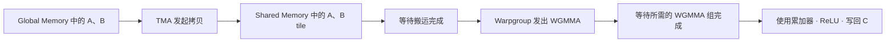

# Tensor Core 与 MMA 入门

本篇沿用 TileLang 的矩阵乘法示例。目标是能在 kernel 里辨认三件事：输入 tile 怎么搬，哪些线程协作计算，什么时候可以读累加结果。前置阅读见 [GPU 执行模型入门](<GPU 执行模型入门.md>) 和 [GPU 内存层级与访存优化](<GPU 内存层级与访存优化.md>)。

## 1. Tensor Core、MMA 和 GEMM 的关系

| 术语 | 含义 | 示例 |
| --- | --- | --- |
| **Tensor Core** | NVIDIA GPU 上执行矩阵乘加的硬件单元 | 对一块矩阵执行乘加，并累加到已有结果 |
| **MMA** | Matrix Multiply-Accumulate，矩阵乘加 | 一次更新 `D = A × B + C` |
| **GEMM** | General Matrix Multiplication，通用矩阵乘法 | 计算整个 `D = α × A × B + β × C`，可以分成许多 tile 和 K 分块 |

设 `A` 的形状为 `M × K`，`B` 为 `K × N`，则 `C` 和 `D` 都为 `M × N`。M 和 N 决定输出形状，**K 是求和的维度**。以一个输出元素为例，`D[i, j] = C[i, j] + Σ A[i, k] × B[k, j]`。在代码里常用 `acc` 表示累加器，写成 `acc ← A × B + acc`。

如果把 K 拆为多块，每一轮累加一份部分结果。比如 `A = [1, 2, 3, 4]` 与 `B = [5, 6, 7, 8]ᵀ`，K 每两个元素分一块。第一块贡献 `1×5 + 2×6 = 17`，第二块贡献 `3×7 + 4×8 = 53`，最终累加得到 `70`。真实 GEMM 同时为一个输出 tile 的许多元素执行这类更新。

**MMA 的输入、累加和最终输出可以使用不同的精度。** 例如 TileLang 的 `quickstart.py` 使用 FP16 的 A、B，FP32 累加器，以及 FP16 输出。FP32 累加可降低长 K 求和过程中的舍入误差，输入转换为 FP16 和最后写回 FP16 时仍会发生舍入。具体可用的 dtype 组合由指令与 GPU 架构决定。[TileLang quickstart.py](examples/quickstart.py) · [PTX ISA 的 Warp MMA 指令](https://docs.nvidia.com/cuda/parallel-thread-execution/index.html#warp-level-matrix-instructions-mma)

## 2. `mma.sync` 由一个 Warp 协作执行

以 `mma.sync.aligned.m16n8k16.row.col.f32.f16.f16.f32` 为例。这里 `m16n8k16` 表示一次指令处理 `M=16、N=8、K=16`，因此 A tile 为 `16 × 16`，B tile 为 `16 × 8`，累加 tile 为 `16 × 8`。`row.col` 表示这条指令要求的 A、B 布局，四个类型后缀依次对应 D、A、B、C。这个例子以 FP16 做输入，累加器与结果使用 FP32。[PTX ISA 的 MMA 指令定义](https://docs.nvidia.com/cuda/parallel-thread-execution/index.html#warp-level-matrix-instructions-mma)

参与单位是**一个 Warp 的 32 个线程**。A、B 和累加器都以 fragment 的形式分布在线程的寄存器中。以输出为例，`16 × 8 = 128` 个 FP32 元素，每个 lane 持有其中 4 个，具体坐标由指令规定。一个 lane 持有哪些元素属于 fragment 布局的一部分，读取结果时必须按该布局解释。

常见的数据路径是 `Global → Shared → 寄存器 fragment → mma.sync → 累加器寄存器`。`ldmatrix` 是一种常见的 Warp 级加载指令，可以把 Shared Memory 中的矩阵片段装入线程寄存器，供 `mma.sync` 使用。`.sync` 和 `.aligned` 规定了 Warp 内一致参与的语义。若 tile 处于矩阵边缘，可以在搬运时为越界输入补零，保持 Warp 的 MMA 指令统一执行，再对写回做边界判断。[PTX ISA 的 MMA 和 ldmatrix](https://docs.nvidia.com/cuda/parallel-thread-execution/index.html#warp-level-matrix-multiply-accumulate-instructions)

## 3. `wgmma` 由一个 Warpgroup 协作执行

Hopper 引入的 WGMMA（Warpgroup Matrix Multiply-Accumulate）以 **4 个连续 Warp，共 128 个线程**为一组，协作发出 `wgmma.mma_async`。例如 FP16 输入可以选用 `m64n64k16`，让一个 Warpgroup 更新 `64 × 64` 的输出子 tile，每次沿 K 累加 16 个元素。WGMMA 是 Hopper 的架构专用指令路径，常见编译目标写作 `sm_90a`。[NVIDIA CUTLASS 的 WGMMA 编程指南](https://docs.nvidia.com/cutlass/4.5.2/media/docs/pythonDSL/mma_docs/wgmma_programming.html)

WGMMA 的 B 操作数来自 Shared Memory，A 可以来自 Shared Memory 或寄存器，具体取决于指令形式。Shared Memory 操作数通过**描述符**传入。描述符编码 tile 的起始位置和布局信息，硬件据此读取数据。累加器仍分布在 Warpgroup 各线程的寄存器中。[NVIDIA CUTLASS 的 WGMMA 操作数说明](https://docs.nvidia.com/cutlass/4.5.2/media/docs/pythonDSL/mma_docs/wgmma_programming.html)

`mma_async` 发出后，计算可以继续在后台进行。手动调度时有三个需要认得的指令：

| 指令 | 在流水线里的作用 |
| --- | --- |
| `wgmma.fence` | 按指令规则约束先前的寄存器访问与后续 WGMMA 对同一批寄存器的访问 |
| `wgmma.commit_group` | 把已发出且尚未提交的 WGMMA 操作归入一个组 |
| `wgmma.wait_group` | 等待已提交的组完成到所需程度。`wait_group 0` 会等待所有已提交组完成 |

发出 WGMMA 前，要按输入的生产方式保证 Shared Memory 数据就绪、对异步计算可见。消费累加结果，或覆盖仍在被读取的 Shared Memory 输入之前，要保证相关组已完成。手写 PTX 时还要按生产路径处理相应的内存顺序和同步要求。[PTX ISA 的异步 Warpgroup MMA](https://docs.nvidia.com/cuda/parallel-thread-execution/index.html#asynchronous-warpgroup-level-matrix-multiply-accumulate-instructions)

## 4. TMA 负责搬运 tile

**TMA（Tensor Memory Accelerator）** 是 Hopper 引入的异步数据搬运硬件，可以在 Global Memory 和 Shared Memory 之间搬运多维 tile。典型的 global→shared 路径由选定线程发起搬运，硬件根据 **tensor map** 和 tile 坐标生成地址。其他线程可以继续处理已就绪的 tile，等本次搬运完成后再消费新数据。PTX 中的多维拷贝常见于 `cp.async.bulk.tensor` 指令族。[CUDA 编程指南的 Asynchronous Data Copies](https://docs.nvidia.com/cuda/cuda-programming-guide/04-special-topics/async-copies.html)

Tensor map 描述源张量的基址、形状、步长和数据类型，也可包含 tile 盒大小和 Shared Memory swizzle 等设置。例如读取 GEMM 的 `A[by * 128 : (by + 1) * 128, ko * 32 : (ko + 1) * 32]` 时，描述符提供张量布局，拷贝指令提供本轮 tile 坐标。支持的拷贝路径有自己的地址对齐、形状和布局约束。[CUDA 编程指南的 Tensor Maps](https://docs.nvidia.com/cuda/cuda-programming-guide/04-special-topics/async-copies.html)

一次典型的 TMA load 用 `mbarrier` 跟踪搬运完成。消费者等待对应阶段的 barrier 后，才能使用 Shared Memory 中的数据。两种描述符分别服务于不同步骤：TMA 的 tensor map 用于描述 Global Memory 张量与搬运布局，WGMMA 的 Shared Memory 描述符用于读取已经搬好的操作数。两者使用的 Shared Memory 布局需要匹配。[CUDA 异步拷贝指南](https://docs.nvidia.com/cuda/cuda-programming-guide/04-special-topics/async-copies.html) · [CUTLASS WGMMA 指南](https://docs.nvidia.com/cutlass/4.5.2/media/docs/pythonDSL/mma_docs/wgmma_programming.html)

## 5. 把搬运和计算接成一条流水线

下面是一条典型的 Hopper GEMM 路径。输入搬运与矩阵乘加各有自己的完成条件。



采用双缓冲时，可以在缓冲区 0 的 tile 上执行 MMA，同时向缓冲区 1 搬下一块。切换缓冲区之前，检查两个依赖。

1. **开始计算前**，等待当前输入 tile 的拷贝完成。
2. **重新填充缓冲区前**，等待上一轮计算完成对该缓冲区的读取。

软件流水线让两件事有机会重叠。多级缓冲也会增加 Shared Memory 用量，并可能降低驻留 Block 数。上篇笔记的合并访存、Shared Memory 布局和 L2 复用仍决定输入能否及时到达计算单元。[TileLang 软件流水线](docs/programming_guides/software_pipeline.md) · [GPU 内存层级与访存优化](<GPU 内存层级与访存优化.md>)

## 6. 对应到 TileLang 的 `quickstart.py`

示例中每个 Block 负责一个 `128 × 128` 输出 tile，每轮读取 `128 × 32` 的 A 和 `32 × 128` 的 B。`K = 1024` 时，一共累加 `1024 / 32 = 32` 轮。下面节选 kernel 的核心计算。[TileLang quickstart.py](examples/quickstart.py)

```python
T.clear(C_local)

for ko in T.Pipelined(T.ceildiv(K, block_K), num_stages=3):
    T.copy(A[by * block_M, ko * block_K], A_shared)
    T.copy(B[ko * block_K, bx * block_N], B_shared)
    T.gemm(A_shared, B_shared, C_local)
```

| 层级 | 本例中的形状或动作 |
| --- | --- |
| Block 的输出 tile | `128 × 128`，由这个 Block 负责写回 |
| 一轮 K 分块 | 取 32 个 K 元素，更新整个 `128 × 128` 累加 tile |
| 一条 MMA 的 tile | 例如 `m16n8k16`，只更新 `16 × 8` 子块的 16 个 K 元素 |

如果用 `m16n8k16` 覆盖这一轮 `128 × 128 × 32` 的计算，按形状可拆为 `8 × 16 × 2 = 256` 个 MMA 子任务，分给各个 Warp。这个数是按所选指令形状计算的覆盖量。实际编译还会选择指令、Warp 布局、重复次数和流水线，阅读生成代码时应以目标架构对应的 lowering 为准。

`T.gemm` 是 TileLang 默认的同步接口。在 Hopper 上选到 WGMMA 时，TileLang 会插入对应的等待。`T.copy` 表示 tile 搬运，具体使用 TMA、其他异步拷贝还是普通拷贝，由目标和合法的布局等条件决定。后面学习手动流水线时，再看显式异步的 `T.wgmma_gemm`、`T.wait_wgmma` 和 `T.tma_copy`。[TileLang GEMM 接口](tilelang/language/gemm_op.py) · [TileLang 拷贝接口](tilelang/language/copy_op.py)

运行 `quickstart.py` 后，可以用 `matmul_relu_kernel.get_kernel_source()` 查看生成的设备源码。有些指令会通过模板或辅助函数展开。进一步确认使用了哪条指令时，可以查看 PTX 或最终的机器指令。这里先记住 `mma.sync` 和 `wgmma.mma_async` 对应计算，`ldmatrix` 和 `cp.async.bulk.tensor` 对应不同层级的搬运。

> [!note] Blackwell 扩展阅读
> 在 Blackwell SM100 的示例中会看到 `tcgen05.mma` 和 Tensor Memory（TMEM）。这一计算路径可把累加器放在 TMEM 中。TMA 是搬运硬件，TMEM 是片上存储，后续读 `examples/gemm_tcgen05` 时再了解具体用法。[NVIDIA CUTLASS 的 tcgen05 MMA 指南](https://docs.nvidia.com/cutlass/4.8.0/media/docs/pythonDSL/guides/mma/tcgen05_programming.html)

## 7. 自测

1. `m16n8k16` 的 A、B、累加器分别是什么形状？这条指令由多少线程协作执行？
2. `threads=128` 能组成几个 Warp 和几个 Hopper Warpgroup？是否能仅凭线程数判断这段 `T.gemm` 的 lowering？
3. 在 TMA 加 WGMMA 的 GEMM 中，等待搬运完成与等待计算完成分别保护什么？
4. `block_K = 32`，如果一条 MMA 的 K 为 16，同一输出子块每轮需要累加几个 K 子块？

> [!success]- 参考答案
> 1. A 是 `16 × 16`，B 是 `16 × 8`，累加器是 `16 × 8`。一个 Warp 的 32 个线程协作执行。
> 2. 4 个 Warp，可构成 1 个 Warpgroup。还需要知道目标架构、dtype、布局和编译器选择。
> 3. 等搬运完成才能读新输入。等相应计算完成才能读累加结果，或安全覆盖该计算仍可能读取的 Shared Memory 输入。
> 4. 两个。它们累加到同一批输出元素上。

返回 [TileLang 学习计划](<TileLang 学习计划.md>)。
